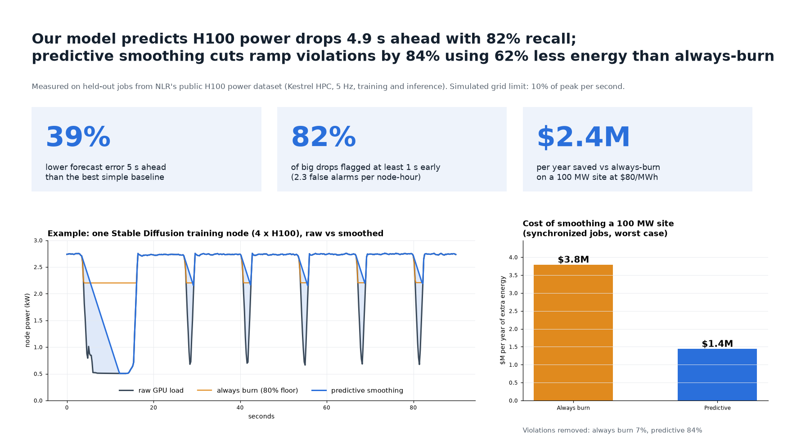
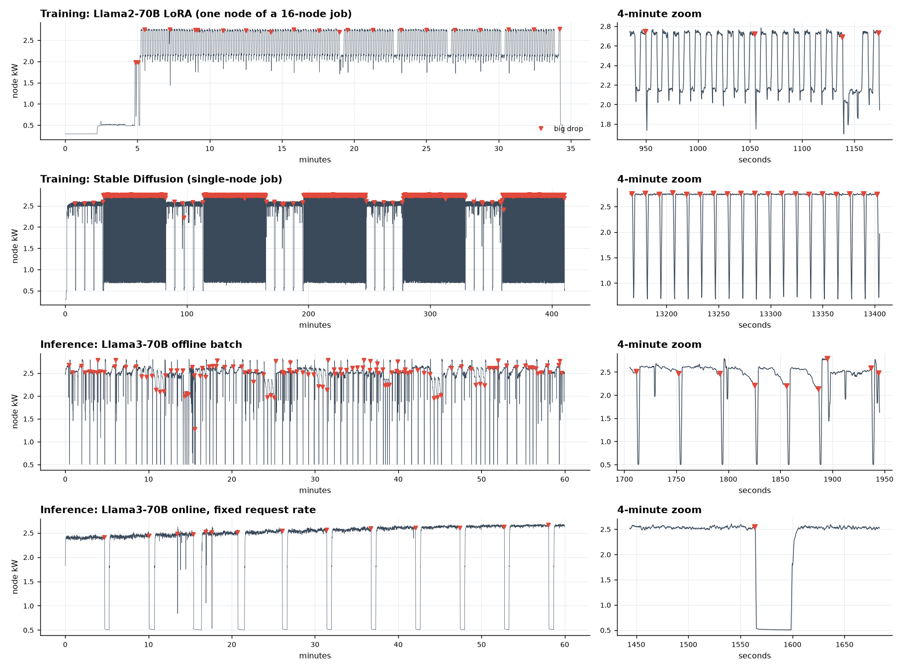
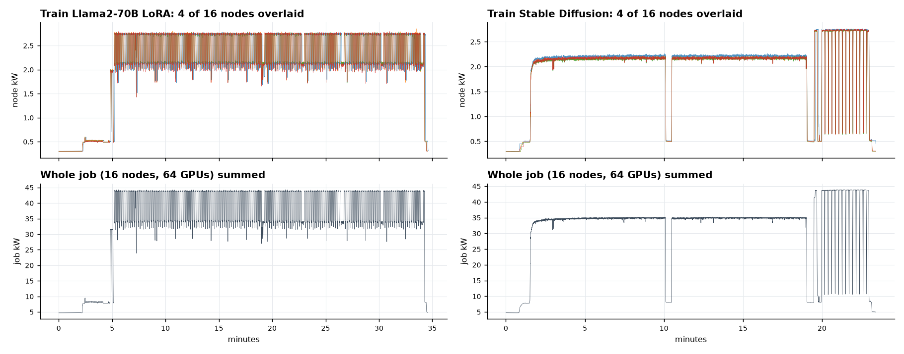
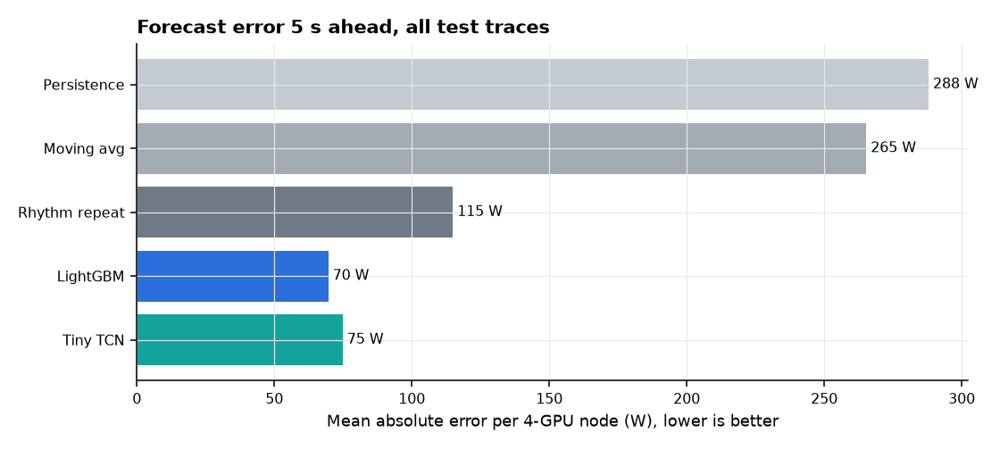
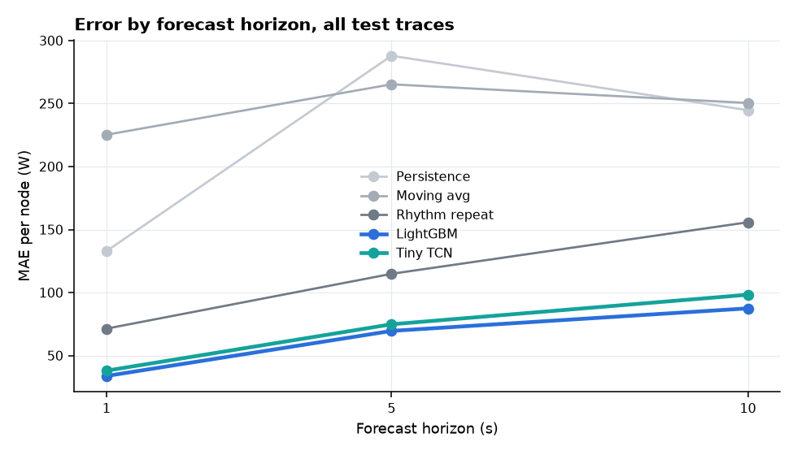
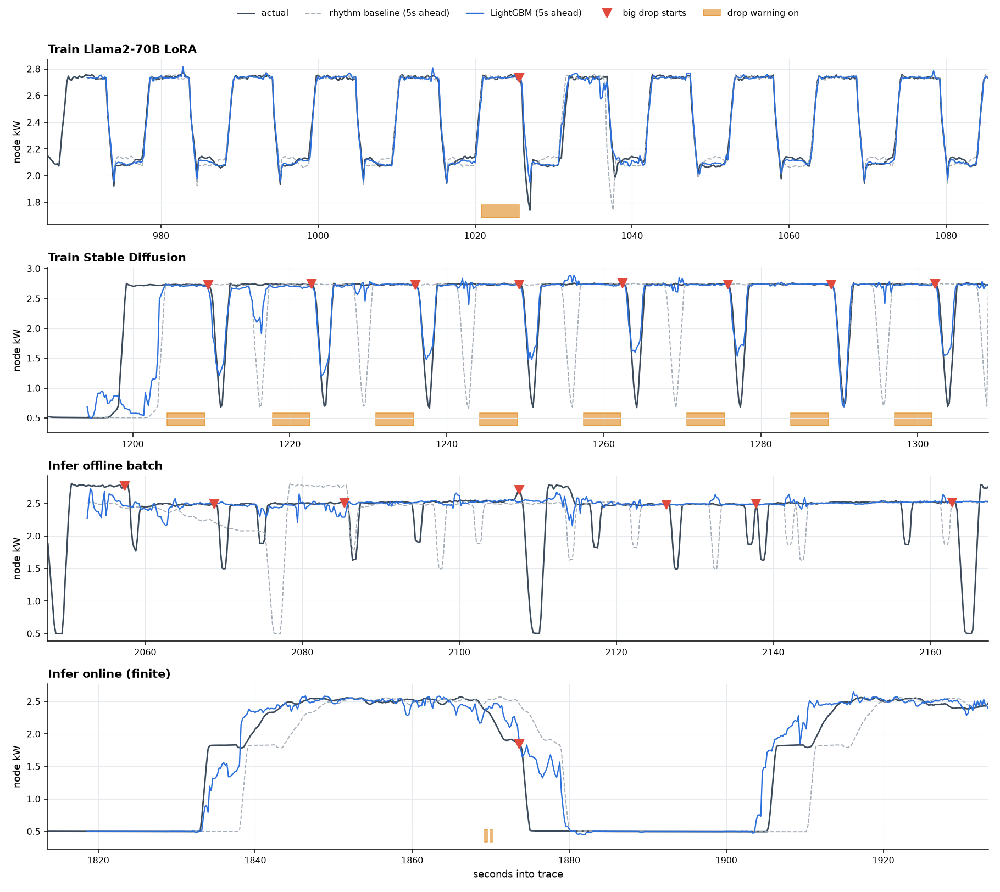
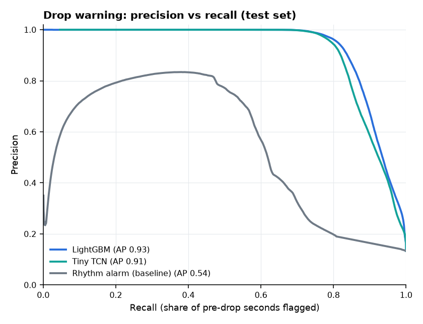
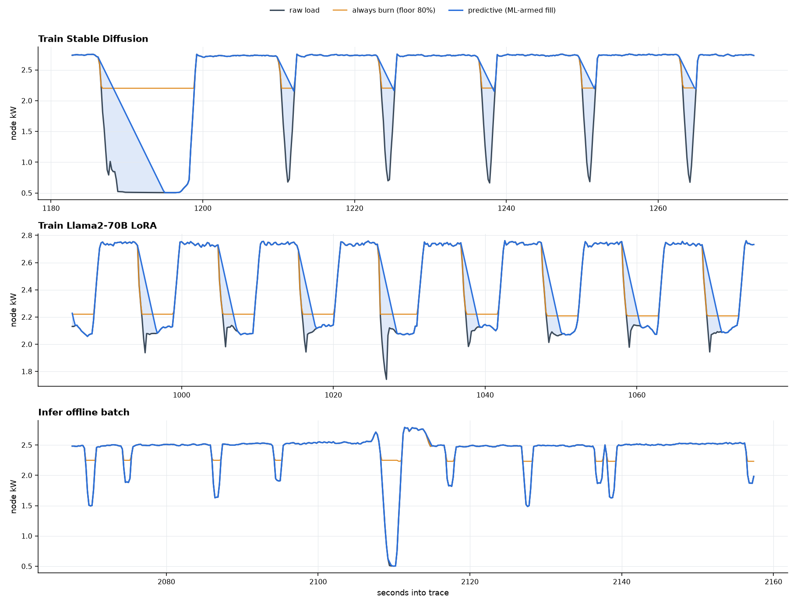
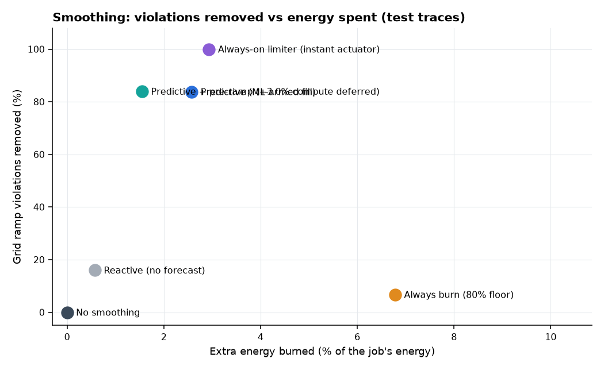
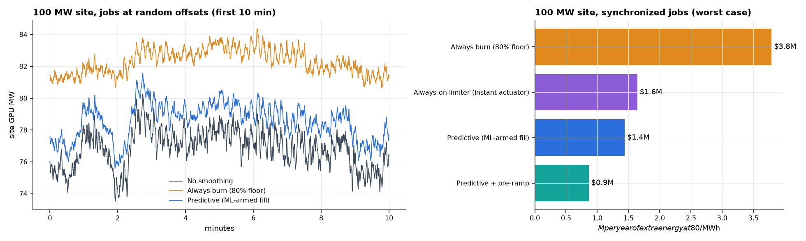

# Power-swing prediction POC: results

_All numbers in this file are generated by `python -m src.run_all` from the NLR H100 dataset. Charts are in `reports/figures/`, raw tables in `reports/tables/`._



## The short version

1. **AI training power really does swing hard and often.** On a single 4-GPU H100 node we found between 24 and 118 "big drops" per hour (power falling by more than 30% within one second). A typical drop sheds 1 to 2 kW per node in about 1.5 seconds. The nodes of a multi-node job drop together (98% of drops line up across nodes, typically within 0.4 s), so a large training run hits the grid as one giant synchronized swing.
2. **Machine learning predicts these swings much better than simple rules.** Five seconds ahead, our primary model (LightGBM, picked on validation data) is off by 70 W per node on average, versus 115 W for the best simple rule ("repeat the last cycle") and 288 W for "assume nothing changes". That is 39% less error than the best rule.
3. **We can warn about drops before they happen.** The drop-warning model flags 82% of big drops at least 1 second in advance, on average 4.9 seconds ahead for the drops it catches (the maximum possible in this setup is 5 s), with 2.3 false alarms per node-hour. A rule-based alarm achieves similar recall only by raising 120 false alarms per hour.
4. **Prediction makes smoothing cheap.** Keeping power at a high floor all the time ("always burn") wastes 6.8% extra energy and still leaves most grid ramp violations in place. Smoothing only when the model expects a drop removes 84% of violations for 2.6% extra energy, 62% less than always-burn. For a 100 MW site that is about **$3.8M versus $1.4M per year** of extra electricity at $80/MWh.
5. **The honest caveats.** The strongest results come from training jobs with regular rhythms (especially Stable Diffusion). Drops caused by jobs or benchmark runs ending are much harder to foresee. The models also do not transfer to job types they have never seen: there, the simple rhythm rule is safer until the model has some history of the new job. And if the smoothing hardware could react instantly, a simple always-on limiter (no ML) would do as well; prediction earns its keep when the smoothing actuator needs a second or more to engage, or when we want to ramp down early instead of burning energy. Details below.

## Success criteria

| Criterion | Result | Status |
|---|---|---|
| Best model beats the rhythm baseline by at least 20% MAE at 5 s | 39% lower MAE (70 W vs 115 W) | **MET** |
| Catches at least 80% of big drops with at least 1 s of warning | 82.4% overall (mean warning 4.9 s). Caveat: 76% of test drops are Stable Diffusion, where recall is very high. Averaged equally over the 5 workload types, recall is 47%. | **MET** overall, not met per workload |
| Predictive smoothing cuts ramp violations by at least 50% while using less extra energy than always-burn | 84% fewer down-ramp violations, 2.6% vs 6.8% extra energy | **MET** |

## 1. The data

NLR (formerly NREL) "Dataset of Generative AI Workload Power Profiles": H100 GPUs on the Kestrel supercomputer, measured every 0.1 to 0.2 seconds. Full description in `data/README_data.md`.

- **Training:** Llama2-70B LoRA fine-tuning (2 to 16 nodes) and Stable Diffusion training (1 to 16 nodes), 46 jobs, about 286 node-hours.
- **Inference:** Llama3-70B served by vLLM in three benchmark styles (offline batches, online bursts, online fixed rate), about 52 hours on one node.
- We use GPU power only (4 H100s per node). Everything is resampled to 5 samples per second.
- Not in the dataset: job crash logs, checkpoint timestamps, step markers, facility meter data. Any statement about "checkpoints" or "communication pauses" would be a guess from the shape of the curve, so we do not make it.



**Big drops by workload** (definition: power falls by more than 30% of the recent 10 s peak within 1 s):

| Workload | Node-hours | Drops | Per node-hour | Median size (W) | Size (% of peak) | Time to bottom (s) | Duration (s) | Steepest fall (W/s) |
|---|---|---|---|---|---|---|---|---|
| inference_offline | 14.0 | 1588 | 113.4 | 1950.9 | 75.4 | 2.4 | 3.0 | 2090.9 |
| inference_online_finite | 19.9 | 1185 | 59.5 | 1370.5 | 63.7 | 5.0 | 30.8 | 1468.2 |
| inference_online_rate | 17.9 | 432 | 24.1 | 1361.8 | 55.8 | 3.8 | 4.4 | 2128.0 |
| train_llama2_70b_lora | 111.3 | 3590 | 32.3 | 1007.3 | 36.5 | 1.2 | 5.2 | 1821.4 |
| train_stable_diffusion | 175.2 | 20745 | 118.4 | 2060.2 | 74.9 | 1.6 | 2.4 | 2177.6 |

Surprises worth knowing:
- **Llama2 LoRA training swings every ~12 seconds** between about 2.75 kW and 2.15 kW per node. That 22% swing is below the 30% "big drop" bar, yet it still breaks a 10%-per-second grid ramp limit every cycle.
- **Stable Diffusion training alternates** between long flat stretches and phases where power plunges to about 650 W every ~12 s. Those phases create most of its drops.
- **Inference drops are mostly benchmark gaps**, where the GPU goes idle between scripted test runs. They are real power swings, but their timing is set by the test harness, not by the model.
- **Multi-node jobs move together**: for 97.6% of drops on one node, every other node of the same job also drops within 5 s; the median offset is 0.0 s and 95% are within 0.4 s (one or two samples, which is also within clock-sync error between nodes).



## 2. Forecasting power 1, 5 and 10 seconds ahead

Error is mean absolute error in watts per 4-GPU node (about 2.2 kW average load). Test set = whole training jobs and the last 20% of each inference session that the models never saw.

| Model | 1 s | 5 s | 10 s |
|---|---|---|---|
| Persistence (last value) | 132.9 | 288.0 | 244.8 |
| Moving average (5 s) | 225.3 | 265.3 | 250.5 |
| Rhythm repeat | 71.4 | 114.9 | 155.8 |
| LightGBM | 33.8 | 69.6 | 87.5 |
| Tiny TCN (46k params) | 38.1 | 74.9 | 98.3 |




**By workload, 5 s ahead (W per node):**

| Workload | Rhythm | LightGBM | TCN | Gain vs rhythm (%) |
|---|---|---|---|---|
| Infer offline batch | 301.6 | 181.9 | 186.8 | 39.7 |
| Infer online (finite) | 284.9 | 128.2 | 147.0 | 55.0 |
| Infer online (rate) | 138.3 | 126.6 | 133.8 | 8.5 |
| Train Llama2-70B LoRA | 71.2 | 38.9 | 44.7 | 45.4 |
| Train Stable Diffusion | 79.0 | 50.2 | 52.6 | 36.5 |

**Pretrained "foundation" forecasters, zero-shot.** These were too slow to run on all 800k test points, so all models are compared on the same 2,000 randomly sampled test points (400 per workload):

| Model | 1 s | 5 s | 10 s |
|---|---|---|---|
| Persistence (last value) | 115.1 | 279.3 | 292.4 |
| Moving average (5 s) | 219.0 | 279.7 | 334.8 |
| Rhythm repeat | 96.8 | 168.4 | 256.7 |
| LightGBM | 49.7 | 106.7 | 144.4 |
| Tiny TCN (46k params) | 59.8 | 114.3 | 159.1 |
| Chronos-Bolt-Small (zero-shot) | 111.6 | 199.0 | 249.1 |
| TimesFM 2.5 (zero-shot) | 68.1 | 144.4 | 229.2 |

Chronos-Bolt-Small is off by 199 W at 5 s (rhythm rule 168 W, LightGBM 107 W) and takes 19 ms per prediction (16x the tiny TCN); TimesFM 2.5 is off by 144 W at 5 s (rhythm rule 168 W, LightGBM 107 W) and takes 191 ms per prediction (162x the tiny TCN). General-purpose pretrained forecasters do not know this data's rhythms; small models trained on it are both more accurate and far cheaper to run.



## 3. Warning about drops ("will a big drop start within 5 s?")

The primary classifier (LightGBM) was picked by validation average precision. Operating thresholds were chosen on validation data (highest threshold that catches 85% of validation drops at least 1 s early; target reached on validation: yes, yes, yes for LightGBM, TCN and the rhythm alarm), then applied unchanged to the test set. Mean warning is averaged over the drops caught at least 1 s early.

| Model | Caught >= 1 s early (%) | Mean warning (s) | False alarms / node-hour | Precision | Recall | F1 | AP |
|---|---|---|---|---|---|---|---|
| LightGBM | 82.43 | 4.87 | 2.28 | 0.97 | 0.78 | 0.87 | 0.93 |
| Tiny TCN | 82.41 | 4.86 | 3.54 | 0.97 | 0.78 | 0.86 | 0.91 |
| Rhythm alarm (baseline) | 83.46 | 4.89 | 120.34 | 0.20 | 0.80 | 0.32 | 0.54 |

"Caught >= 1 s early" counts a drop as caught only if a warning was on at least 1 second before it started. "False alarms" are warning episodes not followed by a drop within 5 s. Precision, recall and F1 are per 0.2 s sample; AP is the area under the precision-recall curve.

**By workload (best classifier):**

| Workload | Drops in test | Caught >= 1 s early (%) | Mean warning (s) | False alarms / node-hour |
|---|---|---|---|---|
| Infer offline batch | 367 | 42.2 | 3.9 | 15.2 |
| Infer online (finite) | 219 | 69.9 | 4.1 | 3.9 |
| Infer online (rate) | 132 | 0.0 | 0.0 | 0.0 |
| Train Llama2-70B LoRA | 315 | 24.1 | 4.4 | 3.0 |
| Train Stable Diffusion | 3247 | 96.8 | 5.0 | 0.4 |

This table is the most important nuance of the project. Regular, rhythmic training drops (Stable Diffusion) are predicted almost perfectly. Drops at the end of an inference run or a job phase are only partly predictable from the power signal alone, and drops in the fixed-rate online inference benchmark are essentially unpredictable. In production, scheduler signals (job ends, batch completions, checkpoint calls) would likely close much of this gap.



## 4. Does it generalize to new kinds of jobs?

Each row retrains LightGBM with one whole workload type removed, then tests on that unseen type.

| Held-out workload (never seen in training) | LightGBM MAE 5 s | Rhythm MAE 5 s | Gain vs rhythm (%) | Drops caught >= 1 s (%) | False alarms / node-hour |
|---|---|---|---|---|---|
| Infer offline batch | 286.0 | 301.6 | 5.2 | 2.7 | 15.8 |
| Infer online (finite) | 327.2 | 284.9 | -14.8 | 0.0 | 0.0 |
| Infer online (rate) | 150.1 | 138.3 | -8.6 | 2.3 | 17.6 |
| Train Llama2-70B LoRA | 380.5 | 71.2 | -434.5 | 59.3 | 346.7 |
| Train Stable Diffusion | 210.2 | 79.0 | -166.0 | 98.9 | 125.2 |

**This is the weakest part of the result.** On a workload type it has never seen, LightGBM beats the rhythm rule on only 1 of 5 workloads, and can be far worse (unseen Train Llama2-70B LoRA: 380 W vs 71 W). Drop warning also degrades: 3 of 5 unseen workloads have recall below 50% (range 0% to 99%), and where recall holds up it comes with up to 347 false alarms per node-hour. The models learn the specific power signatures of the job types they were trained on. The rhythm rule needs no training, so it is the safer choice for a brand-new job type. In practice this means: (a) fall back to the rhythm rule until a new job type has some history, (b) retrain or fine-tune per job type, which is cheap at these model sizes, and (c) train on a much wider variety of jobs than the two training workloads available here.

## 5. Speed (could it run on an edge box?)

| Model | Milliseconds per prediction (CPU, 1 thread) |
|---|---|
| LightGBM (feature computation + 3 horizons + drop classifier) | 10.34 |
| rhythm / persistence / moving-avg baselines (feature computation) | 6.72 |
| tiny TCN (46,148 params, all 4 outputs) | 1.18 |
| chronos-bolt-small (48M params, zero-shot) | 19.35 |
| timesfm-2.5 (200M params, zero-shot) | 190.74 |

Measured on one thread of an Apple-silicon laptop CPU. The tiny TCN needs about 1.2 ms per prediction and LightGBM including all feature calculations about 10 ms, roughly 20 to 200 times inside a 200 ms (5 Hz) control loop. That headroom suggests they would also fit an edge device such as a Raspberry Pi or Jetson, but we have not measured on one. The pretrained foundation models are far heavier.

## 6. What the predictions are worth: smoothing simulation

Settings: grid ramp limit 10% of peak per second; always-burn floor 80% of the last 60 s peak; smoothing actuator (filler GPU work or battery) needs 1.0 s to engage; electricity $80/MWh. All strategies only add power on top of the real load, except "pre-ramp", which also lowers the GPU power cap early and therefore delays a little real work.

How the predictive strategy works: when the drop-warning model fires, or the forecast says power will fall by more than 15% of peak within 5 s, the smoothing actuator is armed. If the load then falls, output is held up and released at the allowed ramp rate instead of crashing.

| Strategy | Down-ramp violations / node-hour | Violations removed (%) | Worst fall (% of peak per s, median node) | Extra energy (%) | Compute deferred (%) |
|---|---|---|---|---|---|
| No smoothing | 184.3 | 0.0 | 70.9 | 0.0 | 0.0 |
| Always burn (80% floor) | 171.8 | 6.7 | 19.7 | 6.8 | 0.0 |
| Predictive (ML-armed fill) | 29.8 | 83.8 | 58.7 | 2.6 | 0.0 |
| Predictive + pre-ramp | 29.6 | 84.0 | 58.7 | 1.5 | 3.0 |
| Reactive, no forecast (reference) | 154.8 | 16.0 | 68.6 | 0.6 | 0.0 |
| Always-on limiter, instant actuator (reference) | 0.0 | 100.0 | 9.0 | 2.9 | 0.0 |




What this shows:
- **Always-burn is expensive and still fails the grid limit.** An 80% floor allows a 20% instant fall, which is twice the 10%/s limit, so it removes only 7% of violations while burning 6.8% extra energy.
- **Predictive smoothing removes 84% of violations for 2.6% extra energy.** The remaining violations are falls the models did not foresee: 37% on Infer online (rate), 32% on Infer offline batch, 25% on Train Stable Diffusion, 3% on Infer online (finite), 2% on Train Llama2-70B LoRA.
- **Reacting without a forecast barely helps (16%)** because a 1 s actuator delay means the drop is already over when smoothing kicks in.
- **Reference point: an always-on limiter** (smoothing permanently armed) would remove every violation for 2.9% extra energy and needs no ML. It is only possible if the actuator is always ready, with zero engage time and zero standby cost, which is the assumption to validate with hardware partners.
- **Pre-ramp** (lower the power cap gradually when a drop is predicted) cuts the energy bill further, to 1.5%, but delays about 3.0% of compute. This is the option that only a predictor can offer.

### Scaling to a 100 MW site

100 MW of H100 GPU capacity (about 35,000 nodes), with the measured duty cycles running all year.

| Case | Strategy | Extra energy (%) | Extra MWh / year | Extra cost / year ($M) | Down-ramp violations / hour |
|---|---|---|---|---|---|
| All synchronized | No smoothing | 0.0 | 0.0 | 0.0 | 184.3 |
| All synchronized | Always burn (80% floor) | 6.8 | 47382.6 | 3.8 | 171.8 |
| All synchronized | Predictive (ML-armed fill) | 2.6 | 17995.5 | 1.4 | 29.8 |
| All synchronized | Predictive + pre-ramp | 1.5 | 10822.9 | 0.9 | 29.6 |
| All synchronized | Reactive, no forecast (reference) | 0.6 | 4011.6 | 0.3 | 154.8 |
| All synchronized | Always-on limiter, instant actuator (reference) | 2.9 | 20506.0 | 1.6 | 0.0 |
| Random offsets | No smoothing | 0.0 | 0.0 | 0.0 | 0.0 |
| Random offsets | Always burn (80% floor) | 7.5 | 51122.6 | 4.1 | 0.0 |
| Random offsets | Predictive (ML-armed fill) | 2.3 | 15990.4 | 1.3 | 0.0 |
| Random offsets | Predictive + pre-ramp | 1.3 | 8610.3 | 0.7 | 0.0 |
| Random offsets | Reactive, no forecast (reference) | 0.5 | 3688.3 | 0.3 | 0.0 |
| Random offsets | Always-on limiter, instant actuator (reference) | 2.7 | 18533.7 | 1.5 | 0.0 |



- **All synchronized (worst case, e.g. one huge training run):** always-burn costs about $3.8M per year (47 GWh), predictive about $1.4M (18 GWh), a saving of about **$2.4M per year** with far better grid compliance.
- **Random offsets (many small independent jobs):** the swings average out. The whole site never falls faster than 2.1 MW per second, well within a 10 MW/s limit, so no smoothing is needed at all. The business case is strongest for sites dominated by large synchronized training jobs, which is exactly where AI is heading.

## Limitations

- **One cluster, one GPU type, short runs.** About 340 node-hours from H100 nodes on one HPC system, with jobs lasting 25 minutes to 7 hours. Production training runs last weeks and include events not present here (checkpoints at scale, failures, restarts).
- **Inference drops are benchmark-driven.** Their timing reflects how the test harness started and stopped runs.
- **GPU power only.** CPUs, memory, networking and cooling are not modeled. Facility-level swings will be somewhat smaller in percentage terms because of this constant overhead.
- **5 Hz sampling.** Real ramps inside 0.2 s are likely steeper than we can see. Sub-second grid effects are not captured.
- **Smoothing is simulated, not tested on hardware.** The actuator latency (1 s), zero standby cost of an armed actuator, and the ramp limit are assumptions. The value of prediction depends heavily on actuator latency (see notebook 03 for a sensitivity sweep).
- **No transfer to unseen job types.** Trained on only two training workloads, the models do worse than the rhythm rule on a training job type they have never seen (section 4).
- **The 80% recall headline is driven by Stable Diffusion drops.** Per workload, recall ranges from about 0% to 97%.
- **Annual figures extrapolate** a few hours of measured behavior to a full year at constant utilization.

## Next steps

1. **Add scheduler and framework signals** (job end, checkpoint start, evaluation phase, batch boundaries). These would let the model foresee the drops that the power signal alone cannot.
2. **Pilot on real hardware**: measure actuator latency and standby cost for GPU filler kernels, power capping and a battery inverter; rerun the simulation with measured values.
3. **Get longer, larger traces** (multi-day, 1,000+ GPU training runs, facility meter data) from a partner data center.
4. **Predict rises as well as drops**, so ramp-up violations can be handled with pre-emptive power capping.
5. **Package the TCN for an edge controller** and test it in a closed loop.

## How to reproduce

```
uv venv --python 3.12 .venv && uv pip install -r requirements.txt   # macOS: brew install libomp
.venv/bin/python -m src.run_all
```
